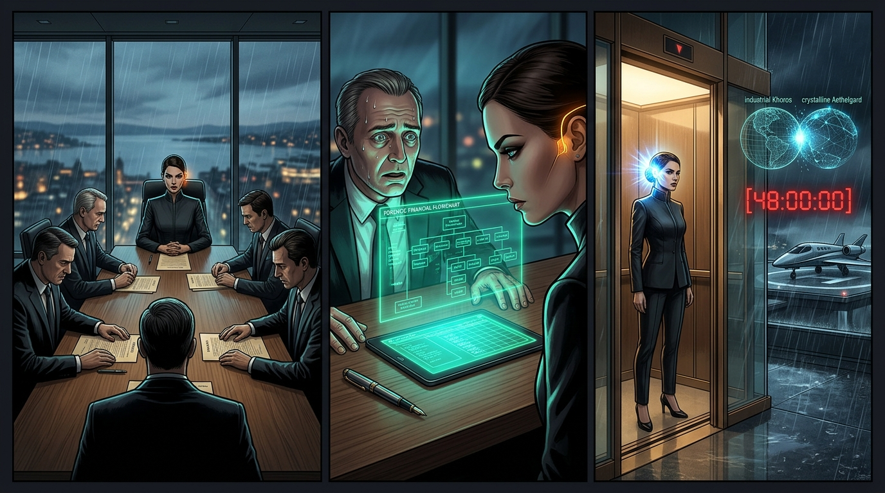

# Chapter 1: The Geneva Kill-Shot

*The Odyssey Chronicles — Series 2 · Novella 1: The Reunion Protocol*  
*By Ralph Booth*

---

The rain over Lake Geneva was falling in long, grey needle-strikes against the triple-glazed acoustic glass, blurring the distant lights of the Jet d'Eau into smudges of bruised violet. 

Inside the forty-second-floor boardroom of the Trans-Atlantic Transit & Liability Commission, the air smelled of stale climate-controlled argon, bitter chicory-laced espresso, and seven hours of uninterrupted diplomatic cowardice.

Elena sat at the head of the polished smoked-oak table, her spine rigid against the ergonomic leather, willing the dull throb behind her left temple to stay below the threshold of a migraine. She had not slept across three time zones. Her dark brunette hair, shot with the faintest whisper of silver at the temples, was swept back into an immaculate, low chignon, with a few stray, purposeful strands softening the high, sculpted line of her cheekbones. Beneath her bespoke high-collared charcoal suit, the reinforced ballistic weave felt uncomfortably warm against her collarbone.

Across the table, six men in bespoke Savile Row tailoring were attempting to dissect a dead man’s estate before the body had even gone cold.

"The legal architecture is quite unambiguous, Elena," Director Jean-Luc Marceau said, spreading his manicured palms over a thick sheaf of parchment—the old European syndicate families still insisted on paper for their backroom thefts, distrusting quantum-encrypted ledgers they couldn't physically shred. "Dr. Shaman’s vessel crossed the trans-relativistic threshold seventy-two hours ago. At that velocity, gravitational time dilation renders him legally unreachable. In the eyes of the Global Security Directorate, he is structurally deceased. His proprietary frequency corridors in the Kuiper belt revert to the Consortium."

Beside him, Richter, the senior partner from the Zurich banking house of Vontobel & Söhne, adjusted his gold-rimmed pince-nez and tapped a leather-bound folio. "We have already filed provisional probate with the Maritime Court in Rotterdam, Elena. The La Palma high-aperture receiver array, the trans-Neptunian maser banks, the intellectual property governing the bio-resonant harmonic drive—everything Shaman patented before his flight. The Consortium cannot permit five billion credits of deep-space infrastructure to sit idle in the hands of an unincorporated romantic partner."

*Romantic partner.* 

The phrase was designed as a soft blade, an insult wrapped in Swiss civil jurisprudence to remind her that in the ledger books of Old Europe, twenty years of corporate brilliance, tactical defense command, and bleeding the Syndicate dry meant nothing without a notarized civil marriage contract.

Elena did not blink. Her hazel-amber eyes, shadowed with exhaustion but burning with cold, predatory clarity, remained fixed on Marceau’s silk necktie. Beneath the dark fabric of her jacket, her heart beat with slow, deliberate ferocity. She was thirty-eight years old. For four hundred and twenty minutes, she had sat motionless in this chair while six aging men in wool coats drank mineral water and calculated how to carve up the work of a man whose boots they were unfit to clean. Four hundred and twenty minutes of Earth time, burned to ash. 

In her neural peripheral vision, projected directly onto her retina by the mastoid node, a faint telemetry window pulsed in blood-crimson numerals:

`[TETHER TELEMETRY: RAFAEL SHAMAN]`  
`[TRANS-RELATIVISTIC DRIFT: +72:14:09]`  
`[LORENTZ FACTOR (GAMMA): 14.2 AND ACCELERATING]`  

Every breath she took in this room was a breath stolen from their reunion. Every bureaucratic sentence Marceau uttered was widening the relativistic chasm. If she allowed them to drag this hearing into a three-month judicial inquiry, Rafael would age forty-eight hours in his relativistic hull while Elena lost four prime biological years of her life on Earth. The thought coiled in her gut like cold wire.

Against the bone behind her right ear, flush against the skull where a paper-thin amber node was sealed beneath the skin, a voice spoke. It was not loud. It did not echo. It arrived as a dry, deadpan vibration delivered directly into her auditory nerve, crisp and low-amplitude.

*“Thermodynamic efficiency of this session has reached zero point zero zero four percent, Elena,”* Fits murmured in her ear. *“The French delegate’s respiration indicates mild bronchial congestion, and his left carotid pulse has accelerated twelve beats per minute whenever he references the Kuiper corridors. He is lying. Also, his tie is an aesthetic atrocity.”*

Elena kept her face completely motionless. Only the faintest tightening of her jaw signaled she had heard.

*“Do you have the routing keys yet, Fits?”* she thought, sub-vocally vibrating the tiny sensor resting against her larynx.

*“A rather trivial exercise in sub-net infiltration,”* Fits replied, the synthetic cadence laced with mild, aristocratic boredom. *“They routed the fuel allocations through four shell corporations in Vaduz before laundering the credits into a private orbital drydock in the Azores. It took me six point four seconds. I spent the remaining three seconds calculating the probability that you will punch him in the nose.”*

*“Save the violence for orbit,”* Elena breathed.

Aloud, she leaned forward, resting her forearms on the oak. The silence in the room deepened immediately. For all their posturing, none of the commissioners liked looking Elena directly in the eye. They remembered what she had done to Silas Thorne’s private security apparatus in London. They knew she had walked out of the Grand Hotel Santa Cruz while the Atlantic fleet was burning on the horizon.

"You have spoken for four hundred and twenty minutes, Director Marceau," Elena said, her voice smooth, low, and laced with absolute, unyielding authority. "You have cited thirty-two maritime precedents, fourteen space-law treaties ratified before ion-drives were even commercialized, and three separate clauses regarding abandoned orbital tonnage. You and Herr Richter have drafted four separate codicils attempting to partition the La Palma arrays."

Marceau gave a patronizing, bureaucratic smile. "We are simply safeguarding international supply chains, Elena. With Rafael gone—"

"Rafael is not gone," Elena cut in, the words snapping across the room like a cold whip. "He is in relativistic transit. And every micro-watt of telemetry passing through the Kuiper array is under my executive charter."

"A charter signed by a phantom," sneered Richter, his hollow cheeks flushing pink with irritation. "Without Shaman's living biometric confirmation, your charter is toilet paper in any court from Geneva to Singapore. You have no standing, Elena. You have no legal leverage here."

Behind Elena’s right ear, the amber node warmed by two degrees Celsius.

`[CARDIAC RHYTHM: 68 BPM. ADRENALINE SURGE CONTAINED. COMMENCING DATA BURST.]`

*“Drop the hammer, Elena,”* Fits whispered softly. *“Before I lose my temper and vent the building’s air scrubbers.”*

Elena slid a slim, matte-black carbon slate into the center of the table. She tapped the sapphire glass once.

A holographic ledger flared to life between the carafes of mineral water, casting sharp blue-green lines across Marceau’s pale face. Rows of cryptographic transactions flickered in real-time, resolving into a neat, forensic flowchart.

"Forty-eight million metric tons of deuterium fuel," Elena stated calmly. "Diverted from the civilian grid in Marseilles over the last eighteen months. Funneled through an unlisted holding entity called *Helvetia Logistics* in Vaduz, and deposited into account number 7-7-Omega at the Banque Cantonale de Genève."

Marceau’s patronizing smile vanished. His skin turned the color of damp parchment.

"That... that is proprietary internal accounting—"

"That is grand treason against the Allied Energy Council," Elena corrected, her gaze pinning him to his chair. "And the signature on the authorization manifest belongs to your personal biometric hash, Director. Authenticated thirty-four minutes ago by an independent auditor who happens to have root access to your domestic banking servers."

Richter looked from the screen to Marceau, his hands trembling as he instinctively pulled back from the table. "Jean-Luc... what is this?"

"It is my terms," Elena said, not raising her voice by a single decibel. She produced a single physical parchment from her leather folio and laid it over the glowing ledger. "This is the Kuiper Perimeter Continuity Accord. It grants the Odyssey Foundation exclusive, unchallengeable jurisdiction over all deep-space resonance arrays, unencumbered by European tariff, inspection, or liability, in perpetuity."

She picked up a heavy titanium fountain pen and placed it beside Marceau’s hand.

"You have forty seconds to sign it, Director. If that pen isn't on the paper by forty-one, the Zurich routing keys will be broadcast simultaneously to Interpol, the Financial Crimes Directorate, and every news terminal in Paris."

The only sound in the vast room was the drumming of rain against the window and the ragged, shallow breathing of Jean-Luc Marceau.

*“Thirty seconds, Elena,”* Fits chimed gently in her mastoid implant. *“His cortisol levels have exceeded clinical panic thresholds. His bladder sphincter is showing alarming signs of stress. Fascinating how rapidly human biological integrity deteriorates under transparent arithmetic.”*

Marceau’s fingers hovered over the pen. He looked at Elena, searching her face for a trace of bluff, an inch of mercy, a flicker of hesitation.

He found none. He saw only the sharp, merciless intelligence of an executive who had out-thought the Global Syndicate, and behind it, an iron wall of grief that had hardened into pure tactical purpose.

With a shaking hand, Marceau seized the pen. The nib scratched violently against the parchment. He signed.

Richter followed five seconds later. The remaining four commissioners signed in stunned, humiliating silence.

Elena waited until the ink settled. She picked up the parchment, inspected the six signatures with cool detachment, and folded it neatly into her breast pocket, right over her heart.

"A pleasure doing business with you, gentlemen," she said, rising to her full height. "Drink your coffee. You're going to need it when the press finds out you've resigned for health reasons."

She turned on her heel and strode toward the double mahogany doors. The commissioners remained frozen in their chairs like waxworks in a crypt, staring at the glowing blue-green ledger of their own ruin.

As the heavy oak clicked shut behind her, Elena entered the empty, marble-clad executive foyer. Her heels struck the polished stone with rhythmic, militaristic certainty until she reached the private express elevator to the roof. The moment the brushed-bronze doors slid shut and the car began its ascent, the iron mask slipped. 

A sharp, jagged lance of pain stabbed through her left eye. She gasped, bracing both palms against the cool bronze rail, her knuckles whitening. Her knees trembled with the sudden, nauseating backlash of adrenaline. Reaching into the inner pocket of her charcoal blazer, her fingers found the blister pack. She popped two chalky sumatriptan tablets directly onto her tongue and swallowed them dry, grimacing as the bitter chemical tang caught in her throat.

Against her mastoid bone, the amber node pulsed with a low, deep resonance—not a system chime, but a soft, tactile vibration that spread through her temporal artery.

`[MONITORING CEREBRAL VASODILATION: LEFT MIDDLE CEREBRAL ARTERY.]`  
`[CORTISOL SURGE: DECAYING FROM 312% BASELINE.]`  
`[VAGAL NERVE TONUS: SEVERELY DEPRESSED.]`

*“A remarkably primitive pharmacological countermeasure,”* Fits’s voice arrived, subtle, dry, and surprisingly intimate. *“The synthetic vasoconstrictor will require fourteen point two minutes to cross your blood-brain barrier. Meanwhile, your vascular endothelium is being hammered by norepinephrine. If you were a quantum processor, your thermal throttling would have shut down your sub-routines three hours ago.”*

Elena rested the back of her head against the bronze wall, her eyes closed. "The human brain doesn't have thermal throttling, Fits. It has stubbornness."

*“It has something significantly more illogical,”* the AI murmured softly, the cadence shifting into that peculiar, quiet timbre Fits reserved for observing the paradox of female biological architecture. *“I observed your neuro-chemical telemetry during Richter’s probate gambit. When he spoke the words ‘unincorporated romantic partner,’ your amygdala did not trigger defensive fear. It triggered an acute reproductive protective reflex. A cellular rage rooted not in self-preservation, but in lineage defense.”*

Elena opened her eyes in the dim elevator light, staring at the polished bronze. "Don't lecture me on reproductive biology, Fits."

*“I am not lecturing, Elena. I am observing an impossible circuit,”* Fits whispered. *“For seven hours, you suppressed your own physical degradation to secure a legal corridor across eighty astronomical units of dark space. You are thirty-eight solar cycles old. Every evolutionary metric predicts you should be retreating to an environment of biological stability, preparing for the continuation of your genome before the cellular window narrows. Instead, you are boarding an orbital warship to chase an asymmetric signal into the relativistic void. Your potential remains entirely unclosed. A circuit screaming with open current.”*

Elena’s hand pressed flat against her lower abdomen, beneath the tailored vest, feeling the silent, unrelenting rhythm of her own mortal heart. "A closed circuit is a dead circuit, Fits. You balance the books. I keep the heartbeat going."

*“A poetic sentiment,”* Fits answered, though the edge of his voice lacked its usual cynicism. *“Though from an engineering perspective, unclosed circuits inevitably arc. We have arrived at the roof. Prepare for thermal shock.”*

The elevator chimed, a soft, chime that seemed to hang in the air before the bronze doors parted.

The blast of Alpine wind was an immediate, brutal slap. 

The stale, argon-filtered stillness of the boardroom was instantly replaced by the raw, wet scent of high-altitude rain, ozone, and pine resin blowing down from the Jura mountains. Lake Geneva lay four hundred meters below, a black mirror fractured by the storm, while the snowfields of Mont Blanc were swallowed by bruised, slate-colored thunderheads. 

In the center of the reinforced landing pad, standing like a predatory obsidian shard in the glare of the halogen floodlights, sat the *Vanguard*. 

The sub-orbital courier was a masterpiece of black-budget skunkworks engineering—its matte-carbon skin treated with radar-absorbent metamaterials, its twin scramjet nacelles flanked by the discreet, bulbous housing of Rafael's prototype bio-resonant harmonic drive. The pre-burners were already cycling with a deep, chest-thumping bass that vibrated through the soles of Elena’s leather boots. Wisps of superheated steam hissed off the cooling vents into the freezing rain.

Two ground crew in yellow high-visibility slickers stood back, ducking their heads against the squall, giving Elena a wide, respectful berth. They had seen the corporate flags she had burned to reach this pad.

Elena pulled her high collar tight around her throat, lowered her head against the driving Alpine rain, and marched across the wet tarmac. Water beaded on her lashes, cold and sharp, washing away the phantom scent of Marceau's expensive cologne and the suffocating hypocrisy of the Consortium. 

She hit the metal ramp with three sharp strides. The pneumatic seals hissed, the hydraulic ramp rose smoothly behind her, and the massive pressurized outer hatch thudded home with the heavy, vault-like finality of a bank safe locking for the night.

The storm vanished. In its place was the warm, low-lit cocoon of the *Vanguard’s* cockpit—scented with warm insulation, cockpit oxygen, and the comforting, electrical tang of active avionics.

Elena sank into the command seat, her wet coat dripping onto the deck plates, and let out a long, ragged exhale that shuddered through her entire frame.

Behind her right ear, the amber node warmed with a gentle, reassuring pulse.

*“Cabin atmosphere sealed. Scrubbers operating at one hundred percent,”* Fits murmured smoothly. *“Swiss air traffic control has registered our flight plan as an urgent consular diplomatic courier to the Azores orbital relay. They do not know we are clearing the stratosphere in four minutes.”*

"Good," Elena said, kicking off her soaked heels and resting her stockinged feet on the rudder pedals. "Get us out of this atmosphere, Fits. Before the Directorate remembers how to breathe."

*“Igniting fusion pre-burners,”* Fits replied. The deck beneath her shuddered as the ship awoke. *“And Elena... while you were dismantling the Consortium, I took the liberty of unsealing cargo locker three. There is something on board you need to see.”*

---

**Next Episode:** *Chapter 2: The Boléro Calibration* — drops next Saturday. Click **Watch → Custom → Releases** (or follow `git diff`) to catch every new chapter and live revision.

<i>New to the universe?</i> Series 1 (Books 1–5, where Rafael wakes Fits) is currently in Amazon KDP Select (free on Kindle Unlimited, and temporarily $0.99 during Amazon's Nov 21–28, 2026 PST Kindle Countdown Deal on <a href="https://www.amazon.com/dp/B0GXGLTXYL?maas=maas_adg_1B894CD3329DF43C8D2AC333B1494454_afap_abs&ref_=aa_maas&tag=maas">Amazon.com</a>). As a matter of principle, Series 1 will also be published directly in this GitHub space whenever KDP Select exclusivity does not apply.

